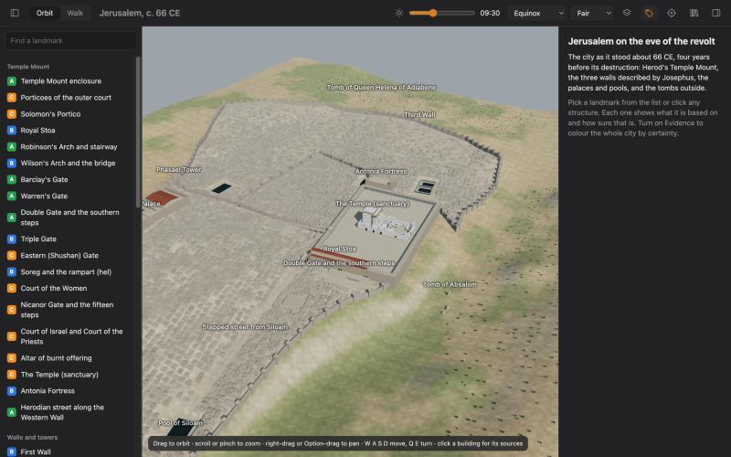
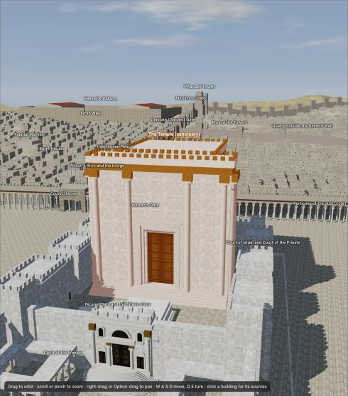

# Jerusalem, c. 66 CE — web edition

Jerusalem on the eve of the Great Revolt in explorable 3D, in the browser: Herod's Temple Mount, the three
city walls described by Josephus, the palaces, pools and streets, and the tombs outside. Every structure
carries its sources and a rating of how well it is attested.

This is a port of the native macOS app (Swift, SceneKit) to JavaScript and [Three.js](https://threejs.org).
The dataset, terrain model, geometry and texture generators are translated one to one, so the web
edition builds the same 59 features, the same ~4,100 houses and the same walk-mode collision grid.



## Run it

There is no build step. Serve the folder with any static web server and open it:

```bash
python3 -m http.server 8080
```

Then open <http://localhost:8080>. (Opening `index.html` straight from disk does not work, because browsers
block ES modules and workers on `file://`.) Three.js r169 is loaded from the jsDelivr CDN through an import
map; everything else is in this repository. The folder can be published as-is on GitHub Pages or any static host.

Needs a browser with WebGL 2 and ES-module workers (current Chrome, Edge, Firefox, Safari).

## Using it

| | |
|---|---|
| **Orbit** | Drag to orbit, scroll or pinch to zoom, right-drag or Option-drag to pan (two fingers on touch screens). W A S D or the arrow keys move the view; Q and E rotate. |
| **Walk** | W A S D or arrows to walk, drag to look, Shift to run. Picking a landmark from the list puts you next to it. |
| **Landmarks** | The sidebar lists every named structure by area. Selecting one flies to it. Clicking a structure in the view selects it. Escape clears the selection. The selection is kept in the URL (`#tm-sanctuary`), so a view can be linked. |
| **Details panel** | For the selected structure: what it is, its measurements, its evidence rating, how far its position may be off, and full citations. |
| **Evidence** | Colours the whole city by how well each structure is attested. |
| **Sun** | The slider sets local solar time; the season menu sets the height of the sun. Shadows follow. |
| **Sky** | Clear, Fair or Cloudy. Clouds drift, and heavy cloud dims and softens the sun. |
| **Sources** | The full bibliography, an accuracy statement, and a list of structures that are attested but not shown. |

## How accurate is it

There is no survey-grade digital record of the first-century city, so "precise" has limits that the app
states rather than hides. In short (the Sources dialog has the full statement):

- **Georeferencing.** The grid is tied to the four corners of the Temple Mount in OpenStreetMap
  (relation 5862584); the enclosure is built from the published wall lengths (488 / 280 / 315 / 470 m) and
  lies within 6 m of the OSM corners, which is tested.
- **Evidence ratings.** **A** standing or excavated in place; **B** excavated fragments plus texts;
  **C** known from texts only; **D** representative infill.
- **The Temple** follows Mishnah Middot and Josephus, placed with the Holy of Holies on the rock under the
  Dome of the Rock (Ritmeyer). **The Third Wall** follows the Sukenik-Mayer line.
- **Terrain** is a reconstruction of the ancient surface interpolated from 14 profiles and 49 spot heights,
  good to 5 to 10 m between control lines; it is not a survey DEM.
- **Not shown:** Herod's theatre, the amphitheatre and the hippodrome, which have never been located.

## How it is built

Everything is generated in the browser at load time from one typed dataset. The masonry textures are cut
in parallel module workers and cached in IndexedDB, so a first visit takes a few seconds and later visits
about two.

```
index.html                 page shell and import map
src/
  geo.js                   grid, frames, polygon maths, 64-bit SplitMix64 random numbers, value noise
  model.js                 Feature, shape constructors, Confidence, Area, materials list
  data/
    bibliography.js        49 sources and the "attested but not shown" list
    cityBase.js            layout constants, wall lines, pools, shape helpers
    terrain.js             control heights and the 5 m heightfield
    templeMount.js         the Temple Mount dataset
    city.js                walls, towers, gates, Upper and Lower City, northern quarters, tombs
    infill.js              representative houses by quarter; assembly of all features
  meshBuilder.js           shapes to triangles, one material group per surface
  walkGrid.js              1 m collision grid for walk mode
  masonry.js               wall masonry measured from photographs; PBR texture generator
  masonryWorker.js         runs the generator off the main thread
  materials.js             materials, procedural textures, house-window shader, sky shader, haze
  scene.js                 terrain mesh, feature meshes, sun model, lighting, overlay, selection
  view.js                  orbit and walk cameras, mouse/touch/keyboard input, picking, labels
  main.js                  sidebar, toolbar, details panel, sources dialog
  styles.css
public/textures/           door textures made from a photograph (see below)
test/data.test.js          data integrity and walk-route checks
```

### What changed from the SceneKit version

- **Rendering** is Three.js `MeshStandardMaterial` with ACES tone mapping and PCF soft shadows. The shadow
  map follows the camera instead of SceneKit's cascades, and is only redrawn when the view or sun changes.
- **Sky and haze.** The sky dome shader is ported to GLSL unchanged. Aerial perspective uses the same
  `1 - exp(-d·density)` curve, patched into three's fog chunk. SceneKit's image-based lighting from a
  gradient sky cube is approximated by a hemisphere light in the same colours.
- **Not ported:** bloom and screen-space ambient occlusion from SceneKit's camera (the masonry still
  carries its own baked-in occlusion maps), and the developer `--snapshot` / `--ui-snapshot` renders.
- Masonry textures are generated at 1024 px (512 px for plain ashlar) instead of 2048 px, to keep the first
  load short.

### Wall masonry and doors from photographs

The wall textures come from measurements of photographs of the standing masonry: block proportions,
course heights, stone and joint colours (see `docs/PHOTO-SOURCES.md`). No photograph is mapped onto a wall.
The golden doors of the Sanctuary and the bronze doors of the Nicanor Gate are textured from the owner's
photograph of a pair of panelled gilt-bronze doors (a Renaissance work, used only for the look of cast
relief panels); the rectified, recoloured results are in `public/textures/`.

Battlements, the corner towers of the Court of the Women, the gilded parapet of the sanctuary and the red
tiled roofs follow the Holyland Model at the Israel Museum (Avi-Yonah, 1966): that model's interpretation,
not excavated evidence.

## Checks

```bash
node --test test/
```

or `deno test --allow-read test/`. The 15 tests cover: every feature cited and every citation resolvable;
geometry inside the terrain; the Temple Mount wall lengths, area and agreement with the OSM outline; the
Royal Stoa's 162 columns and one-stade length; tombs outside the walls and the Holy Sepulchre quarry outside
the Second Wall; deterministic infill; and the original app's walk-mode routes (Siloam to the Temple Mount
by the stepped street, Robinson's stair into the Royal Stoa, the bridge from the Upper City, the outer court
to the Court of the Priests, walls and the soreg blocking except at gates).


